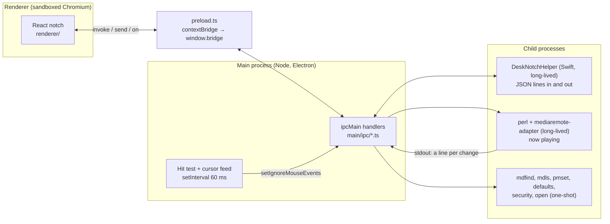

# How CatNotch talks to macOS

This file explains every place CatNotch reaches outside itself into macOS: reading what music is playing, noticing a screenshot, seeing that the microphone is on, and so on. Settings and tasks are left out; they are just a JSON file on disk.

**New to Electron?** Read *Start here* first. **Already know it?** Skip to *For engineers*.

---

## Start here: Electron in five minutes

### What Electron is

A normal website runs in a browser tab and is not allowed to touch your computer: it cannot read your files, see which apps are open, or run programs. That is on purpose; any website could be malicious.

**Electron** lets you build a desktop app out of web technology (HTML, CSS, React) *and* gives it a way to touch the computer. It does this by running your app as **two separate programs** that talk to each other.

### The two halves: renderer and main

Think of a restaurant.

| | Restaurant | CatNotch | Folder |
|---|---|---|---|
| **Renderer** | The dining room: what guests see. Waiters take orders but never cook. | The notch you see: React components, animations, buttons. It is a browser tab, so it **cannot** touch macOS. | [renderer/](../renderer/) |
| **Main** | The kitchen: guests never see it, but it can use the stove, the knives, the fridge. | A Node.js program with full access: files, child processes, the windows themselves. | [main/](../main/) |

They are separate processes and share no memory. The only way to get something from the kitchen is to **pass a note through the hatch**. In Electron that note-passing is called **IPC** (inter-process communication).

### The hatch: the preload bridge

The renderer is not given the whole kitchen, only a small, fixed hatch. That hatch is [main/preload.ts](../main/preload.ts). It runs before the page loads and puts exactly four functions on `window.bridge`:

| Function | Meaning | Restaurant |
|---|---|---|
| `window.bridge.invoke('name', …)` | Ask main a question and **wait for the answer** (returns a Promise). | "One soup, please", then you wait for it. |
| `window.bridge.send('name', …)` | Tell main something; **no answer**. | "Table 4 is leaving." |
| `window.bridge.on('name', fn)` | Let main **tell the page** things whenever they happen. | The kitchen rings a bell: "order up". |
| `window.bridge.pathOf(file)` | The real disk path of a file dropped on the page. | (a special case, for the Shelf) |

The `'name'` is just a label, like `'files:describe'`. It only has to match on both sides. On the main side, the matching code is `ipcMain.handle('name', …)` (answers `invoke`) or `ipcMain.on('name', …)` (receives `send`), and `webContents.send('name', …)` rings the bell for `on`.

A real pair from this repo. The page asks for a file's details:

```ts
// renderer (the dining room): renderer/hooks/useFiles.ts
const items = await window.bridge.invoke('files:describe', ['/Users/me/photo.jpg'])
```

and main answers it:

```ts
// main (the kitchen): main/ipc/files.ts
ipcMain.handle('files:describe', async (_event, paths) =>
  // stat each file, read its icon and thumbnail, send them back
)
```

That is the whole pattern. Every feature below is some version of **the page asks, or main tells, through the hatch**.

### How main actually talks to macOS

Main is Node.js, which can already read files and start programs. For the rest, CatNotch uses four tools:

1. **Electron's own APIs**, which wrap macOS for you: `shell.openPath` (open a file with its app), `shell.trashItem` (the Trash), `nativeImage` (thumbnails), `setIgnoreMouseEvents` (click-through).
2. **Node's `fs`**, for files and folders, including `fs.watch`, which macOS backs with a real "tell me when this folder changes" API.
3. **Command-line tools macOS ships with**: `mdfind` and `mdls` (Spotlight), `defaults`, `pmset` (battery), `security` (Keychain), `open`. Each call is a child process, so main never waits on them.
4. **Two small pieces of native code**, both started as child processes, never loaded into main:
   - **The Swift helper** (`native/mac/`, built as `DeskNotchHelper.app`). It prints one JSON line when a value changes, and answers one JSON line per request on stdin.
   - **The now-playing adapter** (`native/mac/mediaremote-adapter`), run under Apple's own `/usr/bin/perl`.

   There is also one small native addon (`vibrancy.node`) for the Glass blur, loaded with `process.dlopen`.

### Follow one feature end to end: a screenshot

Here is everything that happens, in order, when you press **Cmd+Shift+4**. Every step names the file it happens in.

1. **macOS** saves the picture to the screenshot folder (the Desktop unless you changed it). Nothing of ours yet.
2. **Main** has been watching that folder since start-up with `fs.watch` ([main/ipc/screenshots.ts](../main/ipc/screenshots.ts)). The folder comes from `defaults read com.apple.screencapture location` ([main/mac/spotlight.ts](../main/mac/spotlight.ts)).
3. **Main** checks that it is a new image (born in the last 10 seconds) and waits until the file stops growing.
4. **Main asks Spotlight** (`mdls kMDItemIsScreenCapture`) whether the file is really a screenshot, so any other picture saved to that folder is ignored. The flag can land a moment late, so it asks up to 8 times, 250 ms apart.
5. **Main rings the bell:** `webContents.send('screenshot:new', path)`.
6. **The page** hears it, because [renderer/pages/home.tsx](../renderer/pages/home.tsx) called `window.bridge.on('screenshot:new', …)`.
7. **The page asks** for a thumbnail: `window.bridge.invoke('files:describe', [path])`, and **main answers** with the name, icon and a small preview ([main/ipc/files.ts](../main/ipc/files.ts)).
8. **The page** opens the notch on the capture card ([CaptureView.tsx](../renderer/components/widgets/CaptureView.tsx)) for a few seconds.
9. You press **Discard**. **The page asks** `invoke('screenshot:discard', path)`, and **main** calls `shell.trashItem`, after checking the path really is an image directly inside the screenshot folder. The page is never trusted to delete just anything.

A capture copied to the clipboard only (no file) is missed.

### Why the page never gets more power

It would be simpler to hand the page Node.js directly. It is not done because the renderer is a browser; if anything unexpected ever ran in it, it would have the run of your disk. So the page can only ask for **specific, named things**, and main double-checks each request (is this really a path? is this app one we listed?).

### The map: what each feature uses

| Feature | How | File |
|---|---|---|
| Now playing | The vendored `mediaremote-adapter` streams changes; art is shrunk to 256 px once per track | [main/mac/nowplaying.ts](../main/mac/nowplaying.ts) |
| Play, pause, next, previous | The adapter's `send` command | [main/ipc/media.ts](../main/ipc/media.ts) |
| Open the player | `open -b <bundle id>`, after checking the id | same |
| Notch size | The helper reports the real cutout per display (`safeAreaInsets`); no cutout means a plain pill | [main/mac/helper.ts](../main/mac/helper.ts) |
| Click-through notch | `setIgnoreMouseEvents(…, { forward: true })` plus a cursor poll | [main/main.ts](../main/main.ts) |
| Glass | A native blur view cut to the notch shapes, or a screen capture fallback | [main/mac/vibrancy.ts](../main/mac/vibrancy.ts) |
| Recent files | Spotlight: `mdfind` and `mdls` | [main/mac/spotlight.ts](../main/mac/spotlight.ts) |
| Shelf: thumbnails, drag out, Trash | `nativeImage.createThumbnailFromPath`, `webContents.startDrag`, `shell.trashItem` | [main/ipc/files.ts](../main/ipc/files.ts) |
| Mic and camera dots | The helper reads CoreAudio and CoreMediaIO | `native/mac/Status.swift` |
| Wi-Fi | The helper reads CoreWLAN | same |
| Bluetooth | The helper runs `system_profiler` | same |
| Battery | `pmset -g batt`, re-read on power source changes | [main/ipc/battery.ts](../main/ipc/battery.ts) |
| Most used and installed apps | The `.app` folders, ranked by Spotlight launch counts (`kMDItemUseCount`) | [main/mac/apps.ts](../main/mac/apps.ts) |
| Hide in fullscreen, tuck for browsers | The helper's `foreground` events | [main/fullscreen.ts](../main/fullscreen.ts) |
| CPU, GPU, memory | Node's `os` for CPU; the helper for GPU (IOKit) and memory | [main/ipc/usage.ts](../main/ipc/usage.ts) |
| Calendar | The helper reads EventKit | [main/ipc/calendar.ts](../main/ipc/calendar.ts) |
| Claude sign in for limits | Keychain item `Claude Code-credentials`, read after a consent dialog | [main/ipc/limits.ts](../main/ipc/limits.ts) |
| Updates | Check only; Settings shows the `brew` line | [main/updater.ts](../main/updater.ts) |

---

## For engineers

### Process architecture



The rule it follows: **nothing slow or blocking runs on main's event loop**, because main also owns the windows and relays every IPC message; a stall there freezes the notch. Slow work goes to a child process.

### The helper protocol

`main/mac/helper.ts` starts `DeskNotchHelper.app/Contents/MacOS/DeskNotchHelper` and talks in lines of JSON.

- **Events out.** The helper prints a line when a value changes: `notch`, `foreground`, `mic`, `camera`, `wifi`, `bluetooth`, `calendarChanged`. Features register one listener per event type with `watchHelper`.
- **Watches in.** The helper only polls while a watch is on (`watchForeground`, `watchStatus`, `watchCalendar`). Watches are replayed if the helper restarts.
- **Questions in, answers out.** `askHelper` sends a line with an `id` and waits (3 s by default) for the line carrying the same `id`. It resolves `null` if the helper is gone or silent.
- **Lifetime.** A crash is restarted up to 3 times, then the features stay off. The helper exits when its stdin closes, and also checks every 2 seconds that its parent is still alive, so it never lingers after a crash.
- **Why an app bundle.** Location permission (needed for the Wi-Fi name) cannot be asked by a bare command-line tool. Build it with `npm run build:helper`.

### Cost budget, idle and active

| Work | How often | Cost | Where |
|---|---|---|---|
| Cursor hit test | every 60 ms, always | one `getCursorScreenPoint` and a rectangle check; IPC only when the cursor moved | [main.ts](../main/main.ts) |
| Now playing | event-driven (the adapter streams, debounced 100 ms) | one JSON line per change | [nowplaying.ts](../main/mac/nowplaying.ts) |
| Media key | per click | one short `perl` call | [media.ts](../main/ipc/media.ts) |
| Mic, camera, Wi-Fi | 1 s, while the status watch is on | cheap property reads in the helper; a line only when changed | `native/mac/main.swift` |
| Bluetooth | 30 s | `system_profiler` in the helper, off the helper's main thread | same |
| Foreground watch | 300 ms, only while Hide in fullscreen, Shrink over browsers or Claude prompts need it; started 2 s after launch | the front app and its window bounds; a line only when changed | [fullscreen.ts](../main/fullscreen.ts) |
| Screenshots | event-driven | `fs.watch`; zero cost when idle | [screenshots.ts](../main/ipc/screenshots.ts) |
| Battery | event-driven | `pmset` on a power source change | [battery.ts](../main/ipc/battery.ts) |
| Headphones | event-driven | Chromium's `devicechange`; nothing of ours runs | [useHeadphones.ts](../renderer/hooks/useHeadphones.ts) |
| AI limits | every 2 min while shown, min gap 60 s | one HTTPS call per provider; 5 min back-off after a failure | [limits.ts](../main/ipc/limits.ts) |
| Most used apps | once per 30 min | a folder scan and one `mdls` call over all apps, then cached | [apps.ts](../main/mac/apps.ts) |
| Usage page | when the card asks while flipped to it | `os.cpus()` on request, plus one helper question for GPU and memory | [usage.ts](../main/ipc/usage.ts) |

### Security model

- **The renderer is untrusted by design.** The window keeps Electron's defaults (context isolation on, Node integration off, sandbox on). The page gets four functions through `contextBridge`, never `ipcRenderer` or Node.
- **Every handler validates its input.** Paths must be absolute strings before they reach `shell` ([files.ts](../main/ipc/files.ts)). **Discard** and **rename** only accept an image directly inside the screenshot folder, and discard goes to the Trash, not `unlink` ([screenshots.ts](../main/ipc/screenshots.ts)). **Launch** only accepts an app id that main itself listed ([apps.ts](../main/mac/apps.ts)). **Focus player** only accepts a plain bundle id. **Calendar join** only opens an https Zoom, Meet or Teams link that main itself read from an event.
- **No string-built shell commands from page input.** Child processes are started with `execFile` and an argument list, never through a shell.
- **Glass shapes are cleaned.** Main keeps only well formed rectangles (at most 16) before they reach the native addon.
- **Credentials.** The Claude and Codex OAuth tokens are read from the places those tools already keep them (for Claude, the Keychain item `Claude Code-credentials` after a consent dialog, else its credentials file), used only in main, sent only to their own providers, and never passed to the renderer. No refresh is attempted, because refreshing would rotate the token the tool itself uses.
- **Focus.** The window takes keyboard focus only when pinned, so hovering never steals typing from another app.
- **Permissions the app may ask for:** Location (Wi-Fi name), Screen Recording (Glass), Keychain (Claude limits), Calendars. It asks for no Accessibility, Full Disk Access or Automation permission.

### Things that are subtle

- **`app.getFileIcon` is never used.** On macOS it can kill the whole process natively when a few icons are asked for in a row. Icons come from `nativeImage.createThumbnailFromPath` instead.
- **`startDrag` is modal.** It runs the OS drag loop and returns only when the drop happens. Main times the call; if it blocked for over 120 ms, a real drag happened, and the cursor position at that moment says where it ended, so the Shelf knows whether the file left ([files.ts](../main/ipc/files.ts)).
- **macOS pushes the window down.** A frame is clamped below the menu bar and the cutout, and a screen capture (Glass) shifts it again. The notch window re-pins itself to the display's top edge on `show`, `move` and `resize` ([main.ts](../main/main.ts)).
- **Fullscreen means covering the menu bar.** The helper calls a window full screen only when it covers the whole display; a maximised window stops below the menu bar ([main.swift](../native/mac/main.swift)).
- **A screenshot file is written in several passes.** The watcher only fires once the size is stable across two reads 150 ms apart, and ignores files older than 10 s (renames and touches fire watch events too).
- **Mic and camera say which device, not which app.** macOS does not say who is using it, so the moment text shows "Microphone" or "Camera".
- **Without Location, the Wi-Fi name is hidden.** The notch still shows that there is a network.
- **Rate limits.** Claude's usage endpoint is shared with Claude Code itself and returns 429 quickly. The last good reading is persisted to `userData/limits-cache.json`, so a restart shows numbers instead of "unavailable", and a failure backs off for 5 minutes unless the user presses retry.
- **Quit stops the children.** The helper and the adapter are killed on quit, and the helper also leaves on its own if its parent dies.

### How it fails

A missing helper, adapter or permission turns off only the feature that needs it. Every child process has an error handler, so nothing crashes the main process.

| If this fails | What the user sees |
|---|---|
| The Swift helper is missing or crashing | No privacy dots, Wi-Fi, Bluetooth, calendar or GPU reading; no hardware notch size (a pill is drawn); fullscreen hiding stops working |
| The adapter has no session | The media card disappears; the bar shows the time |
| Spotlight is off | No recent files, no screenshot catcher, no most used apps |
| An AI provider is down or rate-limiting | The last reading stays; with none, a retry card |
| The screenshot folder does not exist | No catcher; the folder is skipped silently |
| An app in the favourites is uninstalled | It drops out of the row on the next lookup |

---

## Releases

Pushing a version tag runs `.github/workflows/release-mac.yml` on a macOS runner. It attaches the universal DMG, zip and `latest-mac.yml` to the release, then updates the Homebrew cask (template in `packaging/homebrew/desknotch.rb`) when a `HOMEBREW_TAP_TOKEN` secret exists. The installed app only reports that a newer version exists; Settings then shows `brew upgrade --cask desknotch`.
